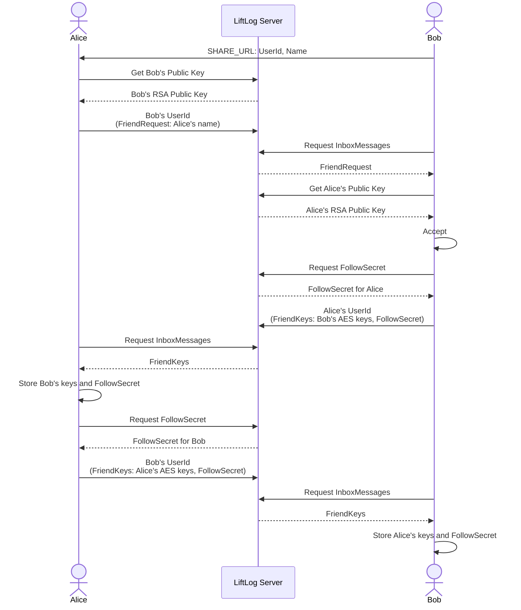
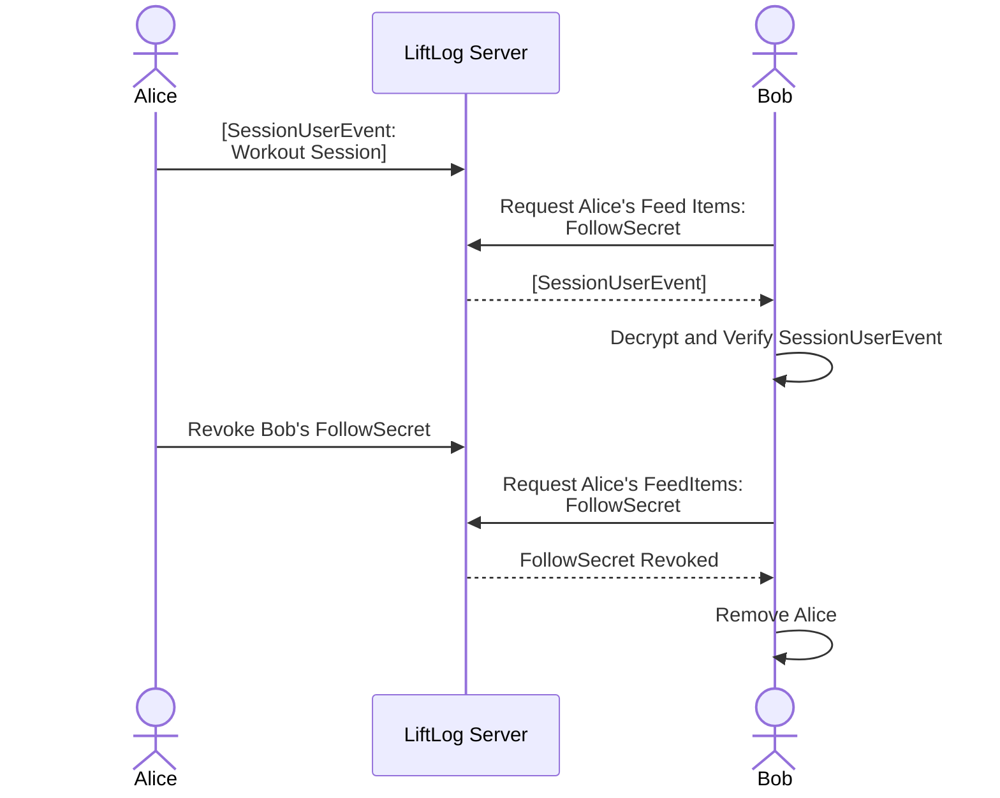

# Feed Process

LiftLog gives users the option of publishing their workouts to a feed that their friends can see. Friends see each other's workouts, including ones still in progress, plan, weekly activity, and can cheer each other's workouts. This is entirely opt in.

Privacy is extremely important to preserve here. Data is end to end encrypted ([see Technical Details](#technical-details)), and users are in full control of who their friends are. Friendship is always mutual, and it always starts with a link and an explicit accept:

1. `Bob` sends his `SHARE_URL` to `Alice`
2. After opening the `SHARE_URL`, `Alice` sends `Bob` a friend request. Nothing of hers is shared yet.
3. `Bob` opens his app, sees that `Alice` wants to be friends (the Feed tab shows a badge), and accepts or denies.
4. If `Bob` accepts, they are both friends. Each sees the other's workouts once the apps have exchanged keys, which happens on their next inbox poll without either of them doing anything.

Users are free to provide any name they like, and a link carries whatever name its sender typed. The share screen says so, and asks users to only send requests to people they know.

## Friends

Each person in the friends list has one of these statuses:

| Status            | Meaning                                                                                        | What the user can do |
| ----------------- | ---------------------------------------------------------------------------------------------- | -------------------- |
| `incoming`        | They asked to be friends.                                                                      | Accept or deny       |
| `pending`         | We asked to be friends and are waiting for them to accept.                                     | Cancel               |
| `friend`          | Mutual friends.                                                                                | Remove               |
| `legacyFollowing` | We followed them in a version with one-way follows, and they did not follow us back.           | Share back or remove |
| `legacyFollower`  | They followed us in a version with one-way follows, and we are waiting for them to share back. | Remove               |

Only `friend` appears in the feed and the calendar, and only a `friend` can cheer or be cheered.

The app accepts automatically only where consent already exists:

- **Crossed requests.** Alice asks Bob while Bob's request to Alice is still waiting, so each has already asked for the other.
- **Asking again.** A request from someone who is already a friend, which happens after they restore a backup
- **Sharing back.** A `legacyFollower` who shares back already had our consent, because we were the one being followed.

### Removing a friend

Either side can remove the other at any time, including cancelling or denying a request. Removing someone:

- removes them from the list and drops any messages still waiting to be sent to them
- tells them, with `Unfriend` (or `FriendReject` for a request we received)
- revokes the `FollowSecret` we issued them, so they can no longer fetch our feed items
- rotates our AES key, if they ever held it ([see Key rotation](#key-rotation))

Being told by the other side does the same, except we do not reply.

### Older relationships and older apps

Versions before friends had one-way follows. When the app upgrades:

- A pair who followed each other become friends.
- A one-way follow becomes `legacyFollowing` for the follower, who is asked to share back, and `legacyFollower` for the person followed. Declining to share back removes the follow.
- Follow requests we had not answered are turned down, and requests we sent are dropped.

Apps that still use follows cannot become friends. A `FollowRequest` from one is turned down automatically, an `UnfollowNotification` is treated as `Unfriend`, and a `FollowResponse` is ignored.

## Technical Details

As mentioned, personal information (including workouts) is end to end encrypted.
Personal Information that is NOT encrypted is limited to:

- Timestamp of request - this is the timestamp of when a feed item was submitted. This could correlate to a time of workout, and therefore could be considered PII.
- Expiry of a feed item. A live workout expires hours after it is published rather than 90 days, so the server can tell that its author is probably training ([see Live workouts](#live-workouts)).
- User ID (a UUID) - this is stored on the device, but is not linked to it (i.e. The LiftLog servers cannot trace userId to device)
- The recipient of an inbox message, and when it was sent as a User ID. The sender is only named inside the encrypted message.

Data is encrypted by the user before sending to the LiftLog server. It is encrypted via AES-GCM, and signed via RSA-PSS to prove who wrote it (see [Payload Encryption](#payload-encryption)). At no point does the server store the unencrypted private keys.
Public keys are stored alongside the user's information.

### Identity

Each install generates an identity, which is stored on THEIR device. An identity consists of:

- An optional name
- An AES-128-GCM key, plus the keys it replaced in the last 90 days ([see Key rotation](#key-rotation))
- An RSA key pair (2048 key size)
- A User ID (UUID)

The client registers its identity with the LiftLog servers by sending ONLY its UserId to the createUser endpoint. If a user does not already exist with that ID the server generates a random `Password` and sends it back to the client. The `Password` is salted and hashed, then stored against the user's ID on the server. This `Password` must be provided when publishing any data for that `UserId` to the server.

The profile (name and current plan) is published encrypted with the current AES key. Workouts are published only while the user has **Publish workouts** turned on.

Using this identity, the client can create a `SHARE_URL`. This url consists of 2 unique parts from the identity:

- UserId
- Name (still optional)

An example share url could look like this (note this is non functional):

```
https://app.liftlog.online/feed/share?id=aDf00f&name=Liam
```

The structure of the url being:
`https://app.liftlog.online/feed/share?id=USER_ID&name=Name`

### Becoming friends

Friends exchange two things: an AES key list, to decrypt each other's feed items and profile, and a `FollowSecret`. A `FollowSecret` is generated by the server for the user who issues it, and acts as a sort of API key, which allows its holder to request that user's **encrypted** feed items. The issuer can revoke it at any time.

When Alice opens Bob's link, the app fetches Bob's public key with the UserId and shows the share screen. If Alice sends the request, her app sends a `FriendRequest` inbox message carrying only her name, and stores Bob as `pending`.

Bob's app receives the request, fetches Alice's public key, and stores her as `incoming`. If Bob accepts, his app issues a `FollowSecret` for Alice and sends her a `FriendKeys` message with his keys and that secret. Alice's app stores them, issues its own `FollowSecret` for Bob, and sends its own `FriendKeys` back. Bob already has a secret for Alice, so his app does not reply again.

A flow chart demonstrating this process is below.
Note items in (are encrypted with RSA public key):



The inbox message types:

| Type            | Payload                                           | On receipt                                                                                                                                                                                                                                                     |
| --------------- | ------------------------------------------------- | -------------------------------------------------------------------------------------------------------------------------------------------------------------------------------------------------------------------------------------------------------------- |
| `FriendRequest` | name                                              | From a stranger: stored as `incoming`. From a `pending`, `friend` or `legacyFollower`: they get our keys. Ignored from a `legacyFollowing`.                                                                                                                    |
| `FriendKeys`    | AES keys (newest first, at most 20), FollowSecret | Replaces their keys and secret. A `pending` or `legacyFollower` becomes a `friend`. Our keys are resent if they were `pending`, or if we asked them to repair the friendship. Ignored from strangers and `incoming`, and when older than the last one applied. |
| `FriendReject`  | none                                              | Ends a request we are waiting on.                                                                                                                                                                                                                              |
| `Unfriend`      | none                                              | Removes them ([see Removing a friend](#removing-a-friend)).                                                                                                                                                                                                    |
| `Reaction`      | a cheer on a feed item                            | Accepted only from a `friend`                                                                                                                                                                                                                                  |

PUT /inbox is unauthenticated by design: anyone who knows a user id can post into its inbox. The signature proves who wrote a message, never that they were entitled to, which is why every rule above checks the sender's status first.

### Publishing and Requesting Feed Items

A user's workout sessions are a type of feed item. When a user finishes a workout with **Publish workouts** on, they create a `SessionUserEvent` payload consisting of that session's data, using the session id as the event id. This payload is signed with their RSA private key, then the payload and the signature are encrypted with their current AES key (see [Payload Encryption](#payload-encryption)). Bodyweight is left out unless the user publishes it.

This encrypted payload is then sent to the LiftLog server as a Feed Item, and is stored encrypted at rest against their UserId. Feed items expire after 90 days.

When a friend requests feed items with a valid FollowSecret, they are returned in this encrypted and signed form. The friend tries each AES key it holds for that user, newest first, then verifies the decrypted payload's signature with the user's RSA public key. If it is valid, it is displayed in their feed.

A flow chart demonstrating this process is below.
Note items in [are encrypted via AES and signed via RSA].



### Live workouts

While a workout is open and **Publish workouts** is on, the app publishes it as a `LiveSessionUserEvent`: the workout so far, under the session's id, signed and encrypted like any other feed item, and expiring 3 hours later. It publishes again whenever the workout changes, at most once a minute.

- **Finishing** publishes the `SessionUserEvent` under the same id, which replaces the live one on the server.
- **Discarding** the workout, or turning **Publish workouts** off during it, publishes a `RemovedSessionUserEvent` in its place.
- Live publishes and the finished workout go out one after another, so a slow live publish cannot land on top of the finished workout.

A live workout is its own event type, rather than a flag on `SessionUserEvent`, so that apps from before it drop it instead of showing a half-done workout as finished.

Friends keep live workouts in memory only, replaced on every fetch, and hide one that has not been published for 30 minutes. They appear as **Training now** above the week's activity and open on the normal workout page, where friends can cheer them. The cheer is keyed by the session id, so it stays with the workout once it is finished.

Nothing pushes these to anyone, so the app polls:

- The feed fetches when it is opened, and every minute while it stays open.
- While a workout is open with **Publish workouts** on, the app checks its inbox every minute, without refreshing the feed, so cheers reach the workout screen while you train. Development builds check every 15 seconds.

### Key rotation

Revoking a `FollowSecret` stops a removed friend fetching new feed items, in addition, we rotate the AES keys used for encrypting our feed items.

1. A new AES key is generated. The old one is marked to expire after 90 days. Expiration is just when we stop sending the key to followers.
2. A `FriendKeys` message is sent to all active friends, containing the new keychain.
3. The profile is published again with the new key.

Friends replace their key list when the `FriendKeys` arrives, and keep reading older feed items with the older keys in it. A previous key is dropped 90 days after it was replaced, when every feed item encrypted with it has expired, so `FriendKeys` never needs more than the last 90 days of keys.

### Repairing a friendship

Delivery is at least once, but a message can still be lost to a bug or a message the server rejects, and restoring an older backup leaves one side behind. Each of these leaves a symptom on at least one side, so the app repairs a friendship when it notices one, after every successful feed fetch:

| Symptom                                                                                                       | Likely cause                                    | Repair                                   | When                                        |
| ------------------------------------------------------------------------------------------------------------- | ----------------------------------------------- | ---------------------------------------- | ------------------------------------------- |
| A `friend`'s profile or feed items decrypt with none of their keys, while their `FollowSecret` is still valid | We missed a rotation, or they restored a backup | `FriendRequest`                          | Straight away, then weekly, at most 4 times |
| A `friend` whose keys never arrived                                                                           | Our accept or their reply was lost              | Our `FriendKeys`, then a `FriendRequest` | After a week, then weekly, at most 4 times  |
| A `pending` request                                                                                           | The request was lost                            | `FriendRequest`                          | Once, after two weeks                       |

### Inbox Message Encryption

Inbox messages are aimed to be small messages which can be encoded and sent to a user with their RSA Public key.
Since RSA has a rather small max payload length, these messages are split into chunks (at most 20), then each chunk is encrypted. These chunks are then sent to the server. The user can use their private key to decrypt the chunks, then stitch them back together to form the original payload. Each message is signed with the sender's RSA private key over the payload, the sender's id and the recipient's id.

### Inbox Message Delivery

Inbox messages are delivered at least once:

- **Sending.** A message is signed and encrypted when it is created, then written to a local outbox (`feed_outbox`). The outbox sends each recipient's messages in order, and retries with backoff when the server cannot be reached. A message the server rejects as invalid is dropped, as are messages to a user the server says does not exist. A message that still has not been sent after 30 days is dropped.
- **Receiving.** The app polls its inbox asking the server to keep messages until they are acknowledged. It decrypts them, writes them to a local queue (`feed_inbox_queue`) and acknowledges them. Messages it cannot read are acknowledged too, so they are not delivered forever. Then it handles the queue in the order the messages were sent.
- **Deduplicating.** Every message carries a `messageId` and a `sentAt` inside its signed payload. Retries can deliver a message more than once, so the app remembers the ids it has queued for 60 days (`feed_inbox_seen`) and skips repeats.

### Payload Encryption

Feed item and profile payloads are signed, then encrypted with AES-GCM. AES-GCM authenticates the ciphertext, so a payload that was modified, or encrypted with a different key, fails to decrypt. That proves only that someone holding the key wrote it, and every friend holds the key, so the RSA signature is still what proves which user wrote it.

On encryption:

1. The SHA256 hash of the payload is calculated - Creating the PayloadHash
2. A signature of the PayloadHash is generated with the RSA private key
3. The signature is appended to the end of the payload - Creating the SignedPayload
4. The SignedPayload is encrypted with AES-GCM under a random 12-byte nonce, and the 16-byte authentication tag is appended - Creating the EncryptedSignedPayload

A nonce is never reused with the same key. A feed item sends its nonce in `encryptedEventIV`. A profile stores each field (name, current plan) as its own nonce, ciphertext and tag, and leaves `encryptionIV` empty.

On decryption, each key held for that user is tried, newest first:

1. The EncryptedSignedPayload is decrypted with AES-GCM - Creating the SignedPayload
2. The last 256 bytes of the SignedPayload are split off - Creating the UnverifiedPayload and the Signature
3. The SHA256 hash of the UnverifiedPayload is calculated - Creating the UnverifiedPayloadHash
4. The Signature is verified using the PublicKey and the UnverifiedPayloadHash
5. If the signature is valid, then the payload is valid

#### AES-CBC keys

Keys created before AES-GCM are AES-CBC, and a key with no recorded algorithm is one of them. They use the same steps with a random 16-byte IV, and a profile encrypts every field under the one `encryptionIV`. AES-CBC does not authenticate ciphertext, so an attacker who knows part of the plaintext can modify it without the key, as described in [this post by Seald](https://www.seald.io/blog/3-common-mistakes-when-implementing-encryption). The signature covers this, because a modified payload hashes differently and its signature no longer verifies.

Shared-item links carry a one-off AES-128-CBC key in the URL.

## Where the code is

All paths are under `app/src/`.

- `store/feed/friend-effects.ts` - friend actions (request, accept, deny, share back, remove) and the inbox handlers for friend messages.
- `store/feed/inbox-effects.ts` - polling, the inbox queue, and routing each message to its handler.
- `store/feed/outbox-effects.ts` - sending the outbox.
- `store/feed/rotation-effects.ts` - key rotation.
- `store/feed/repair-effects.ts` - repairing friendships that drifted out of sync.
- `store/feed/feed-items-effects.ts` - publishing workouts, fetching friends' feed items and profiles.
- `store/feed/live-session-effects.ts` - publishing the workout in progress, and withdrawing it when discarded.
- `store/feed/feed-timeline.ts` - merging your own sessions into the feed.
- `services/feed-follow-service.ts` - building and encrypting inbox messages.
- `services/js-migrations/merge-follows-into-friends.ts` - turning follows into friends.
